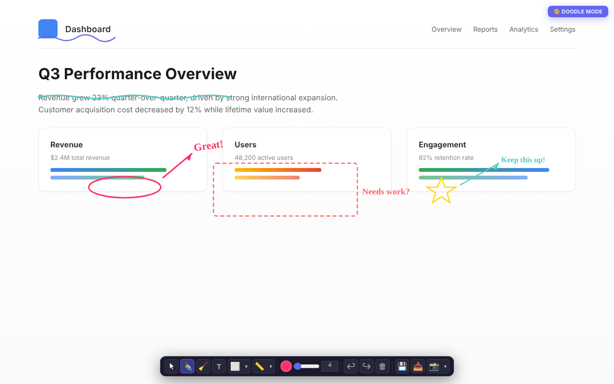

# Page Doodler

Draw, annotate, and mark up any webpage — right in your browser.

Page Doodler adds a floating canvas overlay to any page so you can sketch ideas, highlight content, leave notes, and share annotated screenshots. Your doodles are saved per URL and reload automatically when you return.

> **Want to install it yourself?** [Jump to manual install instructions ↓](#install-it-yourself)

## Demo

## Features

**Drawing Tools**
- Pen with smooth, pressure-friendly strokes
- Eraser to clean up mistakes
- Text tool — click anywhere to type annotations
- 6 shapes: rectangle, rounded rectangle, circle, triangle, diamond, star
- 5 line styles: solid, dashed, dotted, arrow, double arrow
- Full color picker and adjustable brush size (1–100)

**Workflow**
- Undo / Redo / Clear with keyboard shortcuts (Ctrl+Z, Ctrl+Y)
- Save doodles per page — they reload when you come back
- Export your doodle as a transparent PNG
- Screenshot the page with your doodles composited on top
- Region select tool for cropping screenshots to a specific area
- Scroll the page underneath while doodling

## Installation

### From Chrome Web Store
*(Coming soon)*

## How It Works

Page Doodler injects a transparent canvas overlay on top of any webpage. When you activate doodle mode, the canvas captures your pointer input while letting you scroll the page underneath. All strokes, shapes, text, and lines are stored locally per URL using Chrome's storage API.

## Privacy

All data (doodle strokes and tool preferences) is stored locally on your device using Chrome's storage API. No data is collected, transmitted, or shared with any server or third party. The extension works entirely offline after installation.

## Install It Yourself

You can load Page Doodler manually without the Chrome Web Store:

1. **Download** — Click the green **Code** button above, then **Download ZIP**
2. **Unzip** — Extract the downloaded file to a folder on your computer
3. **Open Chrome extensions** — Go to `chrome://extensions` in your browser
4. **Enable Developer mode** — Turn on the toggle in the top-right corner
5. **Load the extension** — Click **Load unpacked** and select the unzipped `page-doodler` folder
6. **Start doodling** — Click the palette icon in your toolbar, then hit **Start Doodling**

Your doodles are saved automatically per page. Come back to any URL and they'll still be there.

## License

MIT
